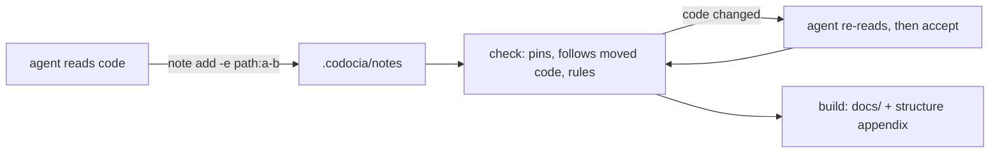

Codocia is a notebook, not a writer: it never calls a model. An agent reads
the code, answers one question per note, and cites the lines that prove it.
Codocia does the parts a model is bad at keeping straight: it pins each
citation to a hash, measures budgets and coverage, checks translations and
compiles the notes into Markdown. Before commit `a7f45d2` Codocia needed a
model; since then the agent writes and Codocia only verifies.

The CLI is `init`, `status`, `note`, `check`, `accept` and `build`, each one
public function in `src/book.rs`, plus `skill`, which prints `SKILL.md`. The
module split is in [[structure]]. Evidence and review are on [[evidence]];
the generated map, translations and output are on [[output]].
