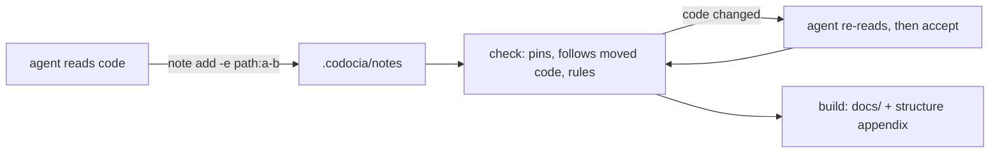

Codocia 是笔记本，不是写手：它从不调用模型。智能体阅读代码，每条笔记回答一个问题，并引用能证明结论的代码行。Codocia 负责模型不擅长长期维持的部分：把每条引用固定到哈希，统计预算和覆盖，检查翻译，再把笔记编译成 Markdown。提交 `a7f45d2` 之前 Codocia 需要模型；此后由智能体写作，Codocia 只做核验。

命令行由 `init`、`status`、`note`、`check`、`accept`、`build` 组成，各自对应 `src/book.rs` 中的一个公开函数；另有 `skill`，用于打印 `SKILL.md`。模块划分见 [[structure]]。证据与审阅见 [[evidence]]；生成的结构图、翻译和输出见 [[output]]。
