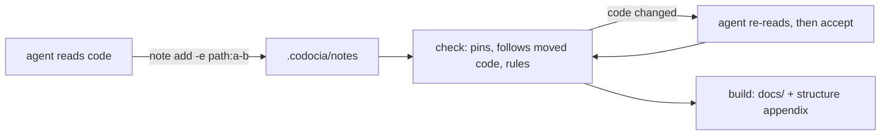

# Overview

**English** · [中文](zh/01-overview.md)

Codocia is a notebook, not a writer: it never calls a model. An agent reads
the code, answers one question per note, and cites the lines that prove it.
Codocia does the parts a model is bad at keeping straight: it pins each
citation to a hash, measures budgets and coverage, checks translations and
compiles the notes into Markdown. Before commit `a7f45d2` Codocia needed a
model; since then the agent writes and Codocia only verifies.

The CLI is `init`, `status`, `note`, `check`, `accept` and `build`, each one
public function in `src/book.rs`, plus `skill`, which prints `SKILL.md`. The
module split is in [Code structure](structure.md). Evidence and review are on [Evidence and review](02-evidence.md);
the generated map, translations and output are on [Structure, translations and build](03-output.md).

Sources: [book.rs:1-6](../src/book.rs#L1-L6) · [main.rs:16-89](../src/main.rs#L16-L89) · [commit a7f45d2](https://github.com/lhwzds/codocia/commit/a7f45d2)

## Where the book lives

`codocia init` creates `.codocia/` in the repository: `book.md` holds the
outline and settings in frontmatter (pages, `ignore`, budgets, `langs`,
`translations`, the pinned `commit`) with the intro as its body; each note
is `notes/<page>/<id>.md`; translations sit in `<lang>/`. `repo:` is stored
as a relative path (`..`), so a clone or CI checkout works unchanged.

Every command finds its book with `find_book_from`: walk up from the current
directory and take the first `.codocia/book.md`, or an older external book
(a directory holding both `book.md` and a notes folder). `--book` overrides the search; a `.codocia` found or created
implicitly must not be a symlink.

`effective_ignore` adds the book directory to the ignore globs, so the notes
never count as code: not in coverage, not in [Code structure](structure.md), and editing a
note does not mean the code moved. Commit `618468e` moved the book into the
repository so the docs travel with the code they describe.

Sources: [book.rs:148-182](../src/book.rs#L148-L182) · [book.rs:215-223](../src/book.rs#L215-L223) · [book.rs:1352-1366](../src/book.rs#L1352-L1366) · [commit 618468e](https://github.com/lhwzds/codocia/commit/618468e)

## Scope, coverage and budgets

The code in scope is what Git tracks or would track
(`git ls-files --cached --others --exclude-standard`), minus `ignore` globs, files over
2 MB, binaries and directories holding a build manifest. Without Git,
`walk_files` walks the tree instead; history and the commit pin are then
simply absent. `status` groups these files into areas and marks an area
covered once any note cites a file in it. Coverage is a map for deciding
what to ignore, not a score.

Budgets scale with the code: under 20k lines `init` writes 4 pages and
2,500 words, under 200k 6 and 4,000, otherwise 8 and 6,000; every book gets
900 words per page and 180 per note. `word_units` counts a Latin word as
one and two CJK characters as one, and skips fenced code, so a Mermaid
diagram is free. Over-budget pages and notes are warnings, never errors.

Sources: [book.rs:255-264](../src/book.rs#L255-L264) · [book.rs:2218-2244](../src/book.rs#L2218-L2244) · [book.rs:2297-2319](../src/book.rs#L2297-L2319) · [book.rs:2127-2148](../src/book.rs#L2127-L2148) · [commit ec1da64](https://github.com/lhwzds/codocia/commit/ec1da64) · +1

## Saving a note

`note add` refuses an invalid page or id slug, a page not in `book.md`, a note without
evidence, and evidence that cannot be pinned (missing file, range past the
end, unknown commit), so a bad citation never reaches the book. It then
echoes each item with its size and first non-blank line, and calls a range
over 120 lines wide: the echo is how the agent notices it cited the wrong
lines. A new note goes after the page's existing ones (`order` + 10);
`--replace` keeps every field that was not given, so fixing a body does not
drop evidence. Like every note write (`note rm`, `follow`, `accept`), it
refuses a symlinked or escaping note path. Notes are plain files, one per note, so agents can write
different pages in parallel and edit them by hand.

Sources: [book.rs:403-493](../src/book.rs#L403-L493) · [book.rs:545-591](../src/book.rs#L545-L591)
