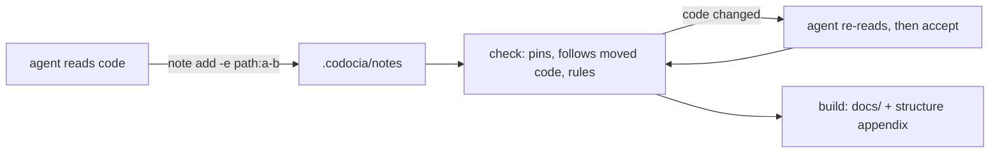
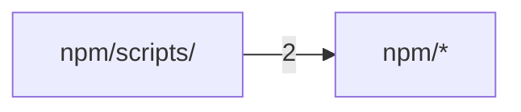

# Codocia

<sub>**English** · [中文](zh/all.md)</sub>

Codocia is a notebook and compiler for AI coding agents: the agent reads a
repository and saves short notes that cite the code, and Codocia keeps those
notes honest as the code moves. This book explains how it works and why, for
an engineer about to change it.

<a id="overview"></a>

## Overview

Codocia is a notebook, not a writer: it never calls a model. An agent reads
the code, answers one question per note, and cites the lines that prove it.
Codocia does the parts a model is bad at keeping straight: it pins each
citation to a hash, measures budgets and coverage, checks translations and
compiles the notes into Markdown. Before commit `a7f45d2` Codocia needed a
model; since then the agent writes and Codocia only verifies.



The CLI is `init`, `status`, `note`, `check`, `accept` and `build`, each one
public function in `src/book.rs`, plus `skill`, which prints `SKILL.md`. The
module split is in [Code structure](#structure). Evidence and review are on [Evidence and review](#evidence);
the generated map, translations and output are on [Structure, translations and build](#output).

<sub>Sources: [book.rs:1-6](../src/book.rs#L1-L6) · [main.rs:16-89](../src/main.rs#L16-L89) · [commit a7f45d2](https://github.com/lhwzds/codocia/commit/a7f45d2)</sub>

### Where the book lives

`codocia init` creates `.codocia/` in the repository: `book.md` holds the
outline and settings in frontmatter (pages, `ignore`, budgets, `langs`,
`translations`, the pinned `commit`) with the intro as its body; each note
is `notes/<page>/<id>.md`; translations sit in `<lang>/`. `repo:` is stored
as a relative path (`..`), so a clone or CI checkout works unchanged.

Every command finds its book with `find_book_from`: walk up from the current
directory and take the first `.codocia/book.md`, or an older external book
(a directory holding both `book.md` and a notes folder). `--book` overrides the search; a `.codocia` found or created
implicitly must not be a symlink.

`effective_ignore` adds the book directory to the ignore globs, so the notes
never count as code: not in coverage, not in [Code structure](#structure), and editing a
note does not mean the code moved. Commit `618468e` moved the book into the
repository so the docs travel with the code they describe.

<sub>Sources: [book.rs:148-182](../src/book.rs#L148-L182) · [book.rs:215-223](../src/book.rs#L215-L223) · [book.rs:1352-1366](../src/book.rs#L1352-L1366) · [commit 618468e](https://github.com/lhwzds/codocia/commit/618468e)</sub>

### Scope, coverage and budgets

The code in scope is what Git tracks or would track
(`git ls-files --cached --others --exclude-standard`), minus `ignore` globs, files over
2 MB, binaries and directories holding a build manifest. Without Git,
`walk_files` walks the tree instead; history and the commit pin are then
simply absent. `status` groups these files into areas and marks an area
covered once any note cites a file in it. Coverage is a map for deciding
what to ignore, not a score.

Budgets scale with the code: under 20k lines `init` writes 4 pages and
2,500 words, under 200k 6 and 4,000, otherwise 8 and 6,000; every book gets
900 words per page and 180 per note. `word_units` counts a Latin word as
one and two CJK characters as one, and skips fenced code, so a Mermaid
diagram is free. Over-budget pages and notes are warnings, never errors.

<sub>Sources: [book.rs:255-264](../src/book.rs#L255-L264) · [book.rs:2218-2244](../src/book.rs#L2218-L2244) · [book.rs:2297-2319](../src/book.rs#L2297-L2319) · [book.rs:2127-2148](../src/book.rs#L2127-L2148) · [commit ec1da64](https://github.com/lhwzds/codocia/commit/ec1da64) · +1</sub>

### Saving a note

`note add` refuses an invalid page or id slug, a page not in `book.md`, a note without
evidence, and evidence that cannot be pinned (missing file, range past the
end, unknown commit), so a bad citation never reaches the book. It then
echoes each item with its size and first non-blank line, and calls a range
over 120 lines wide: the echo is how the agent notices it cited the wrong
lines. A new note goes after the page's existing ones (`order` + 10);
`--replace` keeps every field that was not given, so fixing a body does not
drop evidence. Like every note write (`note rm`, `follow`, `accept`), it
refuses a symlinked or escaping note path. Notes are plain files, one per note, so agents can write
different pages in parallel and edit them by hand.

<sub>Sources: [book.rs:403-493](../src/book.rs#L403-L493) · [book.rs:545-591](../src/book.rs#L545-L591)</sub>

<a id="evidence"></a>

## Evidence and review

A note's evidence is a list of `path`, `path:N`, `path:start-end`,
`commit:<sha>`, `pr:<n>` or `issue:<n>` items in its frontmatter. Paths must
be relative to the repository root; a commit needs at least seven hex
characters. When a file item is first saved, `pin_for` appends ` #hash`: the
first 12 hex digits of a 64-bit FNV-1a hash (`stable_hash_hex`) of the cited
lines with trailing whitespace trimmed, or of the whole file when no range
is given. Everything on this page follows from comparing that hash with the
current file.

The hash is deliberately dumb and stable: no dependency, identical on every
platform, and blind to reformatting at line ends. Changing `hash_lines`
would turn every pin in every existing book into a "code changed" error.

<sub>Sources: [book.rs:1734-1787](../src/book.rs#L1734-L1787) · [book.rs:1810-1826](../src/book.rs#L1810-L1826) · [book.rs:1922-1929](../src/book.rs#L1922-L1929) · [lib.rs:36-43](../src/lib.rs#L36-L43)</sub>

### Following moved code

`evidence_state` decides what a pinned range means today. If the hash still
matches at the cited lines, it is `Ok`. Otherwise it slides a window of the
same length over the file; a match elsewhere is `Moved`, and the nearest
match to the old position wins, so a function shifted by an edit above it
is found again. No match is `Stale` (the code changed) or `BadRange` (the
file got shorter).

`follow` runs at the start of `check`, `accept` and `build` and rewrites
note files in place: moved ranges get their new line numbers, unpinned items
get a pin. A missing file is first looked up in `git_renames`, which runs
`git diff -M` from the book's pinned commit, so a renamed file keeps its
evidence. Commit `fa187ba` folded the old `pin` command into this step,
so only code that really changed needs a person.

<sub>Sources: [book.rs:1873-1919](../src/book.rs#L1873-L1919) · [book.rs:827-867](../src/book.rs#L827-L867) · [book.rs:2585-2616](../src/book.rs#L2585-L2616) · [commit 8c83c23](https://github.com/lhwzds/codocia/commit/8c83c23) · [commit fa187ba](https://github.com/lhwzds/codocia/commit/fa187ba)</sub>

### Reviewing changed code with accept

A `Stale` item is a `check` error until someone re-reads the code, fixes
the note if needed, and runs `codocia accept page/id`. For each stale range
`accept` prints the lines before and after. "Before" comes from the pinned
commit (at the file's old name if it was renamed): `pinned_lines` slides a
window over that version to find the lines whose hash equals the pin, since
`follow` may already have changed the line numbers.

Then the range check: if fewer than 30% of the old lines that contain a letter or digit (trimmed)
still appear in the new range, each new line matching at most one old line, the range now covers different code, for
example a function replaced or moved out of it, and `accept` refuses. It
also refuses when no window of the pinned version matches the pin, so the
check always compares against verified text.
The fix is a corrected range in the note; `--force` skips the check for a
range verified by hand. One refused range leaves the whole note at its old pins.

<sub>Sources: [book.rs:923-1000](../src/book.rs#L923-L1000) · [book.rs:1043-1062](../src/book.rs#L1043-L1062) · [commit 2658f2d](https://github.com/lhwzds/codocia/commit/2658f2d)</sub>

### What else check enforces

Errors make `check` exit non-zero, which is what CI relies on: stale,
missing or out-of-range evidence, a note without evidence or body, a page
not listed in `book.md`, a page link that names no page, and translation
drift ([Structure, translations and build](#output)). Everything else is a warning.

`symbol_warnings` is a cheap guard against invented names. A backticked
identifier (one with `_`, `.` or an uppercase letter, whose last segment
has at least three characters) must occur somewhere in the note's cited files, and a backticked
path ending in `/` or a short extension must exist. It catches typos and
hallucinated APIs, not wrong explanations.

A `commit:` item must exist and be an ancestor of `HEAD` or on an origin
branch (any remote branch when there is no origin), because a commit
rewritten by a rebase can survive locally while its link 404s on the host
(commits `2853a01`, `34b80cd`).

<sub>Sources: [book.rs:1999-2061](../src/book.rs#L1999-L2061) · [book.rs:594-687](../src/book.rs#L594-L687) · [book.rs:1830-1871](../src/book.rs#L1830-L1871) · [commit 2853a01](https://github.com/lhwzds/codocia/commit/2853a01) · [commit 34b80cd](https://github.com/lhwzds/codocia/commit/34b80cd)</sub>

### Repetition through shared evidence

The most common padding in agent-written docs is one mechanism explained on
three pages. `repetition_warnings` detects it from evidence rather than
prose: two notes on different pages that share at least two file ranges,
each overlapping by half the shorter range or more, get a warning naming
both notes and the shared lines. One shared range is an ordinary
cross-reference and passes. The fix is to keep the explanation on one page
and link to it from the others.

<sub>Sources: [book.rs:2064-2109](../src/book.rs#L2064-L2109) · [commit 87bbfdd](https://github.com/lhwzds/codocia/commit/87bbfdd)</sub>

<a id="output"></a>

## Structure, translations and build

### The generated structure map

Agents write file tables that go stale, so Codocia generates the map
instead: every `build` recomputes [Code structure](#structure) from the code, and notes
link to it rather than listing modules. `build_map` takes the in-scope
files and splits them into at most 30 areas by repeatedly splitting the
largest directory; small siblings share an "(other)" row.

For each area it shows the area's own one-line description (from
`Cargo.toml` or `package.json` metadata, a README, a Python package
docstring or a Rust `//!` comment), its three hub files (most imported,
then largest, tests excluded because they import everything), and the
pages whose notes cite it. A Mermaid graph shows the strongest import
dependencies between areas.

`import_edges` resolves imports per language (Python, Rust `use` paths,
JS/TS, Go, C-family includes) to files in the repository; anything external is
dropped. A language without a resolver simply has no edges.

<sub>Sources: [structure.rs:1-5](../src/structure.rs#L1-L5) · [structure.rs:34-130](../src/structure.rs#L34-L130) · [structure.rs:329-350](../src/structure.rs#L329-L350) · [book.rs:2320-2326](../src/book.rs#L2320-L2326) · [commit 38c44b1](https://github.com/lhwzds/codocia/commit/38c44b1) · +2</sub>

### Translations that cannot drift silently

Codocia never translates; it records what each translation was made from.
A book translation is `<lang>/book.md` (title, page titles, intro) plus
`<lang>/<page>/<id>.md` per note, with `source: #hash` in its frontmatter;
the hash covers the source note's title and body, not its evidence, so
re-pinned code does not invalidate the translated text. A repository file pair
lives in `book.md` as `README_CN.md: README.md #hash`.

`check` errors when a translation is missing, has never been synced, or its
source hash changed, and when a translated note's source was deleted.
`parity` then compares the mechanical shape and warns when the heading
count, code blocks (comments ignored), ASCII inline code or external URLs
differ, because those must be identical in every language. `accept zh`
(or `zh/book`, `zh/page/id`, `README_CN.md`) runs `sync`, which writes the
current source hash, refusing a symlinked or escaping file; it does not
judge the prose.

<sub>Sources: [translate.rs:1-13](../src/translate.rs#L1-L13) · [translate.rs:116-131](../src/translate.rs#L116-L131) · [translate.rs:174-245](../src/translate.rs#L174-L245) · [translate.rs:279-312](../src/translate.rs#L279-L312) · [translate.rs:454-512](../src/translate.rs#L454-L512) · +1</sub>

### What build writes

`build` runs `follow` and the full check, and stops on any error unless
`--force` is given. Output goes to `--out`, else the `out:` path in
`book.md` (repository-relative, no `..`), else `docs/` for a `.codocia/`
book and `<book>/out` for an external one. Any output not given with `--out`
must stay inside the repository (or the external book) without passing
through a symlink; only an explicit
`--out` may point elsewhere. It writes `NN-slug.md` per page,
`structure.md`, and `all.md` with every page on one page; the index is
`README.md` inside the repository so the folder renders on GitHub. Each
language in `langs` gets the same set in a `<lang>/` subdirectory, with a
language switch under each title.

Inside the repository, source links are relative (`../src/book.rs#L10-L20`)
and the index names the remote, never a local path. `.codocia-build` lists
every generated file. `prepare_output` checks every destination and the
marker first (no symlinks, nothing outside, a non-manifest marker stops the
build), then deletes only listed files and refuses to overwrite any other
file, so hand-written pages can share `docs/` with the book.

<sub>Sources: [book.rs:1169-1238](../src/book.rs#L1169-L1238) · [book.rs:1438-1448](../src/book.rs#L1438-L1448) · [book.rs:2663-2759](../src/book.rs#L2663-L2759) · [book.rs:2988-3008](../src/book.rs#L2988-L3008) · [translate.rs:529-579](../src/translate.rs#L529-L579) · +3</sub>

### Moving the pinned commit

`book.md` records the commit the notes were last verified against; it is
the "before" for `accept` and the base for rename detection. Every `build`,
even with `--force`, moves it with `move_book_commit`: start at `HEAD` and walk back
through first parents while a commit touched only ignored files, the book
itself, translated repository files or Codocia's generated output.

Without that walk, committing the freshly built `docs/` or a `README_CN.md`
fix would put the pin one commit behind every time, and `status` would
report that the code moved when only documentation did. `code_moved`
skips generated output and ignored files the same way, so `status` does not
flag a commit that only added built docs.

<sub>Sources: [book.rs:1091-1109](../src/book.rs#L1091-L1109) · [book.rs:2548-2583](../src/book.rs#L2548-L2583) · [commit ed8fc0e](https://github.com/lhwzds/codocia/commit/ed8fc0e) · [commit b8905c3](https://github.com/lhwzds/codocia/commit/b8905c3)</sub>

<a id="contributing"></a>

## Contributing

Codocia is one Rust crate with two dependencies (`anyhow`, `clap`); `libc`
only resets `SIGPIPE` on Unix. The modules are in [Code structure](#structure). Tests are
unit tests at the bottom of `book.rs`, `structure.rs` and `lib.rs`. Most build a throwaway Git
repository in the temp directory (`fixture`, `init_in_repo`), commit to it,
and run the real commands, because pinning, renames and the commit walk
only mean something against real history. Before pushing:

```bash
cargo fmt --check
cargo clippy --all-targets -- -D warnings
cargo test
npm test --prefix npm
```

The Tests workflow runs the first three, `codocia check` on this book (from
a full checkout, built from source) and `cargo publish --dry-run` on every
push to `main` and every pull request; a release needs it to pass. `SKILL.md` is compiled into
the binary with `include_str!`, so editing it changes `codocia skill`
output and needs a rebuild. Any change to the hash, the frontmatter format
or the `book.md` keys breaks books already committed in other
repositories; keep old forms readable.

<sub>Sources: [book.rs:3064-3097](../src/book.rs#L3064-L3097) · [book.rs:3618-3627](../src/book.rs#L3618-L3627) · [lib.rs:14-16](../src/lib.rs#L14-L16) · [main.rs:232-242](../src/main.rs#L232-L242) · [test.yml](../.github/workflows/test.yml) · +1</sub>

### Releases and the npm wrapper

Pushing a `v*` tag runs the Release workflow. Its preflight refuses a tag
that is not the latest `origin/main`, has no successful Tests run, or
disagrees with the version in `Cargo.toml` or `npm/package.json`, so bump
both together. It then reruns `cargo fmt --check`, `cargo test`, the npm
tests and both publish dry runs,
builds five targets (macOS and Linux on x64 and arm64, Windows x64),
attaches the archives and `checksums.txt` to a GitHub release, and
publishes the crate and the npm package (with provenance), both through
trusted publishing with no stored token. The Homebrew tap checks for new
releases itself every six hours and updates its formula.

The npm package carries no binary. Its `postinstall` script downloads the
archive for the platform and the package's own version, verifies its
SHA-256 against `checksums.txt`, and installs it as `codocia-bin`;
`bin/codocia` only spawns that file. That is why the npm job waits for the
GitHub release job: without the release assets, installs fail.

<sub>Sources: [release.yml:12-94](../.github/workflows/release.yml#L12-L94) · [release.yml:102-116](../.github/workflows/release.yml#L102-L116) · [release.yml:148-226](../.github/workflows/release.yml#L148-L226) · [install.js:138-170](../npm/scripts/install.js#L138-L170) · [codocia](../npm/bin/codocia) · +1</sub>

<a id="structure"></a>

## Code structure

Generated by Codocia from the code on every build: areas, each area's own description, import dependencies between areas, and the pages that explain them.

In scope: 16 files, 8,064 lines; excluded `Cargo.lock`, `LICENSE`, `.gitignore`, `homebrew-tap-template/**`, `docs/**`, `**/.DS_Store`

### Files

**Repository root**

- (root files) — 370 lines, 4 files. A notebook and compiler that turns what AI agents learn about a codebase into concise, sou…\
  Explained in: [Contributing](#contributing) (1)
- `.github/` — 264 lines, 2 files\
  Explained in: [Contributing](#contributing) (2)
- `src/` — 7,075 lines, 5 files. Library API for Codocia.\
  Hub files: `book.rs` `structure.rs` `lib.rs`\
  Explained in: [Overview](#overview) (4), [Evidence and review](#evidence) (5), [Structure, translations and build](#output) (4), [Contributing](#contributing) (1)

**`npm/`**

- (files) — 103 lines, 2 files. A notebook for AI coding agents that compiles source-grounded, drift-checked docs.\
  Explained in: not covered
- `bin/` — 25 lines, 1 file\
  Explained in: [Contributing](#contributing) (1)
- `scripts/` — 227 lines, 2 files\
  Hub files: `install.js`\
  Explained in: [Contributing](#contributing) (1)


### Dependencies

A → B means files in A import B; the number counts file-level imports. Showing the strongest 1 of 1 edges.


