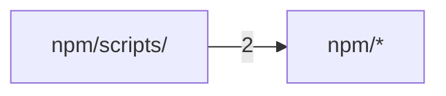

# Code structure

**English** · [中文](zh/structure.md)

Generated by Codocia from the code on every build: areas, each area's own description, import dependencies between areas, and the pages that explain them.

In scope: 16 files, 8,005 lines; excluded `Cargo.lock`, `LICENSE`, `.gitignore`, `homebrew-tap-template/**`, `docs/**`, `**/.DS_Store`

## Files

**Repository root**

- (root files) — 360 lines, 4 files. A notebook and compiler that turns what AI agents learn about a codebase into concise, sou…\
  Explained in: [Contributing](04-contributing.md) (1)
- `.github/` — 269 lines, 2 files\
  Explained in: [Contributing](04-contributing.md) (2)
- `src/` — 7,021 lines, 5 files. Library API for Codocia.\
  Hub files: `book.rs` `structure.rs` `lib.rs`\
  Explained in: [Overview](01-overview.md) (4), [Evidence and review](02-evidence.md) (5), [Structure, translations and build](03-output.md) (4), [Contributing](04-contributing.md) (1)

**`npm/`**

- (files) — 103 lines, 2 files. A notebook for AI coding agents that compiles source-grounded, drift-checked docs.\
  Explained in: not covered
- `bin/` — 25 lines, 1 file\
  Explained in: [Contributing](04-contributing.md) (1)
- `scripts/` — 227 lines, 2 files\
  Hub files: `install.js`\
  Explained in: [Contributing](04-contributing.md) (1)

## Dependencies

A → B means files in A import B; the number counts file-level imports. Showing the strongest 1 of 1 edges.

