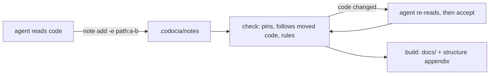

# 概览

[English](../01-overview.md) · **中文**

Codocia 是笔记本，不是写手：它从不调用模型。智能体阅读代码，每条笔记回答一个问题，并引用能证明结论的代码行。Codocia 负责模型不擅长长期维持的部分：把每条引用固定到哈希，统计预算和覆盖，检查翻译，再把笔记编译成 Markdown。提交 `a7f45d2` 之前 Codocia 需要模型；此后由智能体写作，Codocia 只做核验。

命令行由 `init`、`status`、`note`、`check`、`accept`、`build` 组成，各自对应 `src/book.rs` 中的一个公开函数；另有 `skill`，用于打印 `SKILL.md`。模块划分见 [代码结构](structure.md)。证据与审阅见 [证据与审阅](02-evidence.md)；生成的结构图、翻译和输出见 [结构、翻译与构建](03-output.md)。

来源: [book.rs:1-6](../../src/book.rs#L1-L6) · [main.rs:16-89](../../src/main.rs#L16-L89) · [commit a7f45d2](https://github.com/lhwzds/codocia/commit/a7f45d2)

## 书放在哪里

`codocia init` 在仓库中创建 `.codocia/`：`book.md` 的 frontmatter 存放大纲和设置（页面、`ignore`、预算、`langs`、`translations`、固定的 `commit`），正文是引言；每条笔记是 `notes/<page>/<id>.md`；翻译放在 `<lang>/`。`repo:` 存为相对路径（`..`），所以克隆的仓库或 CI 检出无需改动即可使用。

每个命令都用 `find_book_from` 找书：从当前目录逐级向上，取第一个 `.codocia/book.md`，或旧式的外部书（同时含 `book.md` 和笔记目录的目录）。`--book` 可覆盖这一查找；自动找到或创建的 `.codocia` 不能是符号链接。

`effective_ignore` 把书目录加入忽略规则，因此笔记永远不算代码：不计入覆盖，不出现在 [代码结构](structure.md)，修改笔记也不算代码变动。提交 `618468e` 把书移进仓库，让文档跟随它所描述的代码一起流转。

来源: [book.rs:148-182](../../src/book.rs#L148-L182) · [book.rs:215-223](../../src/book.rs#L215-L223) · [book.rs:1367-1381](../../src/book.rs#L1367-L1381) · [commit 618468e](https://github.com/lhwzds/codocia/commit/618468e)

## 范围、覆盖与预算

纳入范围的代码是 Git 跟踪或将会跟踪的文件
（`git ls-files --cached --others --exclude-standard`），再去掉 `ignore` 匹配的文件、超过 2 MB 的文件、二进制文件，以及含构建清单的目录。没有 Git 时，`walk_files` 直接遍历目录树；此时没有历史，也没有固定提交。`status` 把这些文件分成若干区域，只要有笔记引用了某区域内的文件，该区域就算已覆盖。覆盖是一张用来决定忽略什么的地图，不是分数。

预算随代码规模变化：少于 2 万行时 `init` 写入 4 页、2,500 词，少于 20 万行时为 6 页、4,000 词，否则 8 页、6,000 词；每本书都是每页 900 词、每条笔记 180 词。`word_units` 把一个拉丁词计为 1，两个 CJK 字符计为 1，并跳过围栏代码，所以 Mermaid 图不占预算。页面或笔记超出预算只是警告，不是错误。

来源: [book.rs:255-264](../../src/book.rs#L255-L264) · [book.rs:2440-2466](../../src/book.rs#L2440-L2466) · [book.rs:2519-2541](../../src/book.rs#L2519-L2541) · [book.rs:2349-2370](../../src/book.rs#L2349-L2370) · [commit ec1da64](https://github.com/lhwzds/codocia/commit/ec1da64) · +1

## 保存笔记

`note add` 会拒绝以下笔记：页面或 id 的 slug 不合法、页面不在 `book.md` 中、没有证据，或证据无法固定（文件不存在、行范围超出文件末尾、提交不存在），因此错误的引用永远进不了书。随后它逐项回显证据的大小和第一行非空内容，超过 120 行的范围会被标为过宽：智能体靠这段回显发现自己引错了行。新笔记排在该页已有笔记之后（`order` + 10）；`--replace` 保留所有未给出的字段，所以修改正文不会丢掉证据。和其他写笔记的操作（`note rm`、`follow`、`accept`）一样，它拒绝符号链接或逃出书目录的笔记路径。笔记是普通文件，一条一个文件，多个智能体可以并行写不同页面，也可以手工编辑。

来源: [book.rs:403-493](../../src/book.rs#L403-L493) · [book.rs:545-591](../../src/book.rs#L545-L591)
