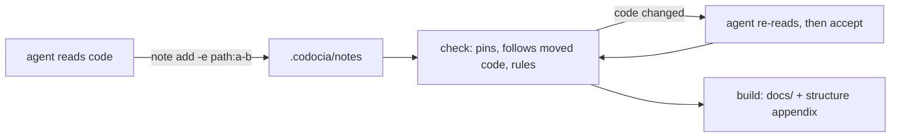
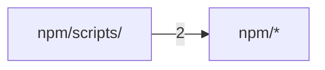

# Codocia

<sub>[English](../all.md) · **中文**</sub>

Codocia 是给 AI 编程智能体用的笔记本和编译器：智能体阅读仓库，保存引用代码的简短笔记；代码变动时，Codocia 负责让这些笔记保持可信。本书面向准备修改 Codocia 的工程师，讲清它如何工作、为什么这样设计。

<a id="overview"></a>

## 概览

Codocia 是笔记本，不是写手：它从不调用模型。智能体阅读代码，每条笔记回答一个问题，并引用能证明结论的代码行。Codocia 负责模型不擅长长期维持的部分：把每条引用固定到哈希，统计预算和覆盖，检查翻译，再把笔记编译成 Markdown。提交 `a7f45d2` 之前 Codocia 需要模型；此后由智能体写作，Codocia 只做核验。



命令行由 `init`、`status`、`note`、`check`、`accept`、`build` 组成，各自对应 `src/book.rs` 中的一个公开函数；另有 `skill`，用于打印 `SKILL.md`。模块划分见 [代码结构](#structure)。证据与审阅见 [证据与审阅](#evidence)；生成的结构图、翻译和输出见 [结构、翻译与构建](#output)。

<sub>来源: [book.rs:1-6](../../src/book.rs#L1-L6) · [main.rs:16-89](../../src/main.rs#L16-L89) · [commit a7f45d2](https://github.com/lhwzds/codocia/commit/a7f45d2)</sub>

### 书放在哪里

`codocia init` 在仓库中创建 `.codocia/`：`book.md` 的 frontmatter 存放大纲和设置（页面、`ignore`、预算、`langs`、`translations`、固定的 `commit`），正文是引言；每条笔记是 `notes/<page>/<id>.md`；翻译放在 `<lang>/`。`repo:` 存为相对路径（`..`），所以克隆的仓库或 CI 检出无需改动即可使用。

每个命令都用 `find_book_from` 找书：从当前目录逐级向上，取第一个 `.codocia/book.md`，或旧式的外部书（同时含 `book.md` 和笔记目录的目录）。`--book` 可覆盖这一查找；自动找到或创建的 `.codocia` 不能是符号链接。

`effective_ignore` 把书目录加入忽略规则，因此笔记永远不算代码：不计入覆盖，不出现在 [代码结构](#structure)，修改笔记也不算代码变动。提交 `618468e` 把书移进仓库，让文档跟随它所描述的代码一起流转。

<sub>来源: [book.rs:148-182](../../src/book.rs#L148-L182) · [book.rs:215-223](../../src/book.rs#L215-L223) · [book.rs:1352-1366](../../src/book.rs#L1352-L1366) · [commit 618468e](https://github.com/lhwzds/codocia/commit/618468e)</sub>

### 范围、覆盖与预算

纳入范围的代码是 Git 跟踪或将会跟踪的文件
（`git ls-files --cached --others --exclude-standard`），再去掉 `ignore` 匹配的文件、超过 2 MB 的文件、二进制文件，以及含构建清单的目录。没有 Git 时，`walk_files` 直接遍历目录树；此时没有历史，也没有固定提交。`status` 把这些文件分成若干区域，只要有笔记引用了某区域内的文件，该区域就算已覆盖。覆盖是一张用来决定忽略什么的地图，不是分数。

预算随代码规模变化：少于 2 万行时 `init` 写入 4 页、2,500 词，少于 20 万行时为 6 页、4,000 词，否则 8 页、6,000 词；每本书都是每页 900 词、每条笔记 180 词。`word_units` 把一个拉丁词计为 1，两个 CJK 字符计为 1，并跳过围栏代码，所以 Mermaid 图不占预算。页面或笔记超出预算只是警告，不是错误。

<sub>来源: [book.rs:255-264](../../src/book.rs#L255-L264) · [book.rs:2218-2244](../../src/book.rs#L2218-L2244) · [book.rs:2297-2319](../../src/book.rs#L2297-L2319) · [book.rs:2127-2148](../../src/book.rs#L2127-L2148) · [commit ec1da64](https://github.com/lhwzds/codocia/commit/ec1da64) · +1</sub>

### 保存笔记

`note add` 会拒绝以下笔记：页面或 id 的 slug 不合法、页面不在 `book.md` 中、没有证据，或证据无法固定（文件不存在、行范围超出文件末尾、提交不存在），因此错误的引用永远进不了书。随后它逐项回显证据的大小和第一行非空内容，超过 120 行的范围会被标为过宽：智能体靠这段回显发现自己引错了行。新笔记排在该页已有笔记之后（`order` + 10）；`--replace` 保留所有未给出的字段，所以修改正文不会丢掉证据。和其他写笔记的操作（`note rm`、`follow`、`accept`）一样，它拒绝符号链接或逃出书目录的笔记路径。笔记是普通文件，一条一个文件，多个智能体可以并行写不同页面，也可以手工编辑。

<sub>来源: [book.rs:403-493](../../src/book.rs#L403-L493) · [book.rs:545-591](../../src/book.rs#L545-L591)</sub>

<a id="evidence"></a>

## 证据与审阅

笔记的证据是 frontmatter 中的一组条目，形式为 `path`、`path:N`、`path:start-end`、`commit:<sha>`、`pr:<n>` 或 `issue:<n>`。路径必须相对于仓库根目录；提交至少要有七个十六进制字符。文件条目第一次保存时，`pin_for` 会追加 ` #hash`：对所引行（去掉行尾空白）计算 64 位 FNV-1a 哈希（`stable_hash_hex`），取前 12 个十六进制位；没有给出行范围时对整个文件计算。本页的一切都来自把这个哈希与当前文件比较。

这个哈希有意做得简单而稳定：不依赖任何库，在所有平台上结果一致，也不受行尾格式变化影响。改动 `hash_lines` 会让所有现有书里的每个固定值都变成“代码已变”错误。

<sub>来源: [book.rs:1734-1787](../../src/book.rs#L1734-L1787) · [book.rs:1810-1826](../../src/book.rs#L1810-L1826) · [book.rs:1922-1929](../../src/book.rs#L1922-L1929) · [lib.rs:36-43](../../src/lib.rs#L36-L43)</sub>

### 跟随移动的代码

`evidence_state` 判断一个已固定的范围现在处于什么状态。若哈希在所引行处仍然匹配，就是 `Ok`。否则它在文件上滑动一个等长窗口；在别处匹配到就是 `Moved`，并取离原位置最近的匹配，所以上方插入代码导致下移的函数能被重新找到。完全没有匹配则是 `Stale`（代码已变）或 `BadRange`（文件变短了）。

`follow` 在 `check`、`accept` 和 `build` 开始时运行，并就地改写笔记文件：移动过的范围更新为新行号，未固定的条目补上固定值。文件不存在时，先在 `git_renames` 中查找；它从书的固定提交起运行 `git diff -M`，所以重命名的文件不会丢失证据。提交 `fa187ba` 把原来的 `pin` 命令并入这一步，只有真正改动的代码才需要人来处理。

<sub>来源: [book.rs:1873-1919](../../src/book.rs#L1873-L1919) · [book.rs:827-867](../../src/book.rs#L827-L867) · [book.rs:2585-2616](../../src/book.rs#L2585-L2616) · [commit 8c83c23](https://github.com/lhwzds/codocia/commit/8c83c23) · [commit fa187ba](https://github.com/lhwzds/codocia/commit/fa187ba)</sub>

### 用 accept 审阅变动的代码

`Stale` 条目在 `check` 中一直是错误，直到有人重读代码、必要时修改笔记，并运行 `codocia accept page/id`。对每个过期范围，`accept` 打印变动前后的代码行。“变动前”取自固定提交（文件改过名时用旧名）：由于 `follow` 可能已经改了行号，`pinned_lines` 在那个版本上滑动窗口，找出哈希等于固定值的那些行。

接着是范围检查：如果旧版本中含字母或数字的行（去掉首尾空白）在新范围中出现的比例不到 30%（每个新行最多匹配一个旧行），说明该范围现在覆盖的是另一段代码，例如函数被替换或移出了范围，`accept` 会拒绝。固定版本中没有任何窗口与固定值匹配时，它同样拒绝，因此总是和经过验证的文本比较。正确做法是在笔记里改正范围；`--force` 只用于已手工核对过的范围，会跳过检查。只要有一个范围被拒绝，整条笔记都保留原来的固定值。

<sub>来源: [book.rs:923-1000](../../src/book.rs#L923-L1000) · [book.rs:1043-1062](../../src/book.rs#L1043-L1062) · [commit 2658f2d](https://github.com/lhwzds/codocia/commit/2658f2d)</sub>

### check 的其他规则

错误会让 `check` 以非零状态退出，CI 正依赖这一点：证据过期、缺失或超出范围，笔记没有证据或正文，页面未列在 `book.md` 中，页面链接指向不存在的页面，以及翻译漂移（[结构、翻译与构建](#output)）。其余都是警告。

`symbol_warnings` 是防止编造名称的廉价检查。反引号中的标识符（含 `_`、`.` 或大写字母，且最后一段至少三个字符）必须出现在笔记所引的某个文件中；以 `/` 或短扩展名结尾的反引号路径必须存在。它能抓住拼写错误和臆造的 API，抓不住错误的解释。

`commit:` 条目必须存在，并且是 `HEAD` 的祖先或位于 origin 的某个分支上（没有 origin 时任意远程分支均可），因为被 rebase 改写的提交可能仍留在本地，而它在托管平台上的链接已经 404（提交 `2853a01`、`34b80cd`）。

<sub>来源: [book.rs:1999-2061](../../src/book.rs#L1999-L2061) · [book.rs:594-687](../../src/book.rs#L594-L687) · [book.rs:1830-1871](../../src/book.rs#L1830-L1871) · [commit 2853a01](https://github.com/lhwzds/codocia/commit/2853a01) · [commit 34b80cd](https://github.com/lhwzds/codocia/commit/34b80cd)</sub>

### 通过共享证据发现重复

智能体写的文档里最常见的冗余，是同一机制在三个页面上各讲一遍。`repetition_warnings` 依据证据而不是文字来发现它：不同页面上的两条笔记若共享至少两个文件范围，且每处重叠都不少于较短范围的一半，就会收到警告，列出两条笔记和共享的行。只共享一个范围属于正常的交叉引用，不会报警。解决办法是只在一个页面讲解，其他页面链接过去。

<sub>来源: [book.rs:2064-2109](../../src/book.rs#L2064-L2109) · [commit 87bbfdd](https://github.com/lhwzds/codocia/commit/87bbfdd)</sub>

<a id="output"></a>

## 结构、翻译与构建

### 生成的结构图

智能体写的文件表很快就会过时，所以 Codocia 改为自动生成：每次 `build` 都从代码重新计算 [代码结构](#structure)，笔记只需链接它，不必罗列模块。`build_map` 取范围内的文件，反复拆分最大的目录，最多分成 30 个区域；较小的同级目录合并为一行 "(other)"。

每个区域会显示：区域自带的一行描述（取自 `Cargo.toml` 或 `package.json` 元数据、README、Python 包的 docstring 或 Rust 的 `//!` 注释），三个枢纽文件（先按被导入次数，再按大小排序；排除测试，因为测试几乎导入一切），以及哪些页面的笔记引用了它。一张 Mermaid 图展示区域之间最强的导入依赖。

`import_edges` 按语言把导入解析到仓库内的文件（Python、Rust `use` 路径、JS/TS、Go、C 系 include）；外部依赖直接丢弃。没有解析器的语言就没有依赖边。

<sub>来源: [structure.rs:1-5](../../src/structure.rs#L1-L5) · [structure.rs:34-130](../../src/structure.rs#L34-L130) · [structure.rs:329-350](../../src/structure.rs#L329-L350) · [book.rs:2320-2326](../../src/book.rs#L2320-L2326) · [commit 38c44b1](https://github.com/lhwzds/codocia/commit/38c44b1) · +2</sub>

### 不会悄悄漂移的翻译

Codocia 从不翻译；它只记录每份翻译是根据哪个源文本做的。书的翻译包括 `<lang>/book.md`（标题、页面标题、引言）和每条笔记对应的 `<lang>/<page>/<id>.md`，frontmatter 中带 `source: #hash`；哈希覆盖源笔记的标题和正文，不含证据，所以重新固定代码不会使译文失效。仓库文件的翻译对写在 `book.md` 中，形如 `README_CN.md: README.md #hash`。

翻译缺失、从未同步、源哈希已变，或所译笔记的源已被删除时，`check` 报错。之后 `parity` 比较机械结构：标题数量、代码块（忽略注释）、ASCII 行内代码或外部 URL 不一致时发出警告，因为这些在每种语言中都必须相同。`accept zh`（或 `zh/book`、`zh/page/id`、`README_CN.md`）会运行 `sync`，写入当前的源哈希，并拒绝符号链接或逃出目录的文件；它不评判译文质量。

<sub>来源: [translate.rs:1-13](../../src/translate.rs#L1-L13) · [translate.rs:116-131](../../src/translate.rs#L116-L131) · [translate.rs:174-245](../../src/translate.rs#L174-L245) · [translate.rs:279-312](../../src/translate.rs#L279-L312) · [translate.rs:454-512](../../src/translate.rs#L454-L512) · +1</sub>

### build 写出什么

`build` 先运行 `follow` 和完整检查，有任何错误就停止，除非给出 `--force`。输出目录依次取 `--out`、`book.md` 中的 `out:` 路径（相对于仓库，不能含 `..`），否则 `.codocia/` 中的书写到 `docs/`，外部书写到 `<book>/out`。凡不是用 `--out` 指定的输出目录，都必须留在仓库内（外部书则在书目录内），且路径上不能有符号链接；只有显式的 `--out` 可以指向别处。它为每页写一个 `NN-slug.md`，外加 `structure.md`，以及把所有页面合在一页的 `all.md`；在仓库内部时索引名为 `README.md`，让该目录在 GitHub 上直接显示。`langs` 中的每种语言在 `<lang>/` 子目录下生成同样一套文件，每个标题下有语言切换。

在仓库内部，源码链接是相对路径（`../src/book.rs#L10-L20`），索引只写远程仓库名，从不写本地路径。`.codocia-build` 列出所有生成的文件。`prepare_output` 先检查每个目标路径和标记文件（不允许符号链接，不能逃出目录，标记文件不是清单时构建直接停止），然后只删除清单中的文件，并拒绝覆盖任何其他文件，因此手写页面可以和书共用 `docs/`。

<sub>来源: [book.rs:1169-1238](../../src/book.rs#L1169-L1238) · [book.rs:1438-1448](../../src/book.rs#L1438-L1448) · [book.rs:2663-2759](../../src/book.rs#L2663-L2759) · [book.rs:2988-3008](../../src/book.rs#L2988-L3008) · [translate.rs:529-579](../../src/translate.rs#L529-L579) · +3</sub>

### 移动固定提交

`book.md` 记录笔记最后一次核验所对应的提交；它是 `accept` 的“变动前”版本，也是重命名检测的基准。每次 `build`（包括带 `--force` 时）都会用 `move_book_commit` 移动它：从 `HEAD` 开始沿第一父提交回退，只要某个提交只改动了被忽略的文件、书本身、仓库翻译文件或 Codocia 生成的输出，就继续回退。

没有这一步，每次提交刚构建的 `docs/` 或修正 `README_CN.md` 都会让固定提交落后一个，`status` 也会在只有文档变化时报告代码已变。`code_moved` 以同样方式跳过生成的输出和被忽略的文件，所以只添加构建文档的提交不会被 `status` 标记。

<sub>来源: [book.rs:1091-1109](../../src/book.rs#L1091-L1109) · [book.rs:2548-2583](../../src/book.rs#L2548-L2583) · [commit ed8fc0e](https://github.com/lhwzds/codocia/commit/ed8fc0e) · [commit b8905c3](https://github.com/lhwzds/codocia/commit/b8905c3)</sub>

<a id="contributing"></a>

## 参与开发

Codocia 是一个 Rust crate，只有两个依赖（`anyhow`、`clap`）；`libc` 只用于在 Unix 上重置 `SIGPIPE`。模块划分见 [代码结构](#structure)。测试是 `book.rs`、`structure.rs` 和 `lib.rs` 末尾的单元测试。大多数测试在临时目录中建一个一次性 Git 仓库（`fixture`、`init_in_repo`），提交后运行真实命令，因为固定、重命名和提交回退只有在真实历史上才有意义。推送前运行：

```bash
cargo fmt --check
cargo clippy --all-targets -- -D warnings
cargo test
npm test --prefix npm
```

Tests 工作流在每次推送到 `main` 和每个 pull request 时运行前三项、对这本书的 `codocia check`（完整检出、从源码构建）以及 `cargo publish --dry-run`；发布需要它通过。`SKILL.md` 通过 `include_str!` 编译进二进制，所以修改它会改变 `codocia skill` 的输出，并且需要重新构建。对哈希、frontmatter 格式或 `book.md` 键的任何改动，都会破坏其他仓库中已提交的书；请保持旧格式可读。

<sub>来源: [book.rs:3064-3097](../../src/book.rs#L3064-L3097) · [book.rs:3618-3627](../../src/book.rs#L3618-L3627) · [lib.rs:14-16](../../src/lib.rs#L14-L16) · [main.rs:232-242](../../src/main.rs#L232-L242) · [test.yml](../../.github/workflows/test.yml) · +1</sub>

### 发布与 npm 包装

推送 `v*` 标签会运行 Release 工作流。它的预检会拒绝以下标签：不是最新的 `origin/main`、没有成功的 Tests 运行，或版本号与 `Cargo.toml` 或 `npm/package.json` 不一致，所以两者要一起升版本。随后它重跑 `cargo fmt --check`、`cargo test`、npm 测试和两个发布演练，构建五个目标（macOS 和 Linux 的 x64 与 arm64，以及 Windows x64），把压缩包和 `checksums.txt` 附到 GitHub release，再发布 crate、npm 包（带 provenance）并更新 Homebrew tap。

npm 包本身不带二进制。它的 `postinstall` 脚本按平台和包自身的版本下载对应压缩包，用 `checksums.txt` 校验 SHA-256，并安装为 `codocia-bin`；`bin/codocia` 只负责启动这个文件。因此 npm 任务要等 GitHub release 任务完成：没有发布资产，安装就会失败。

<sub>来源: [release.yml:12-94](../../.github/workflows/release.yml#L12-L94) · [release.yml:102-116](../../.github/workflows/release.yml#L102-L116) · [release.yml:148-236](../../.github/workflows/release.yml#L148-L236) · [install.js:138-170](../../npm/scripts/install.js#L138-L170) · [codocia](../../npm/bin/codocia) · +1</sub>

<a id="structure"></a>

## 代码结构

本页由 Codocia 根据代码自动生成，每次 build 重新计算：功能区划分、各区自带的说明、区之间的 import 依赖，以及讲解各区的页面。

范围内共 16 个文件，8,074 行；已排除 `Cargo.lock`、`LICENSE`、`.gitignore`、`homebrew-tap-template/**`、`docs/**`、`**/.DS_Store`

### 文件结构

**仓库根目录**

- （根目录文件） — 370 行，4 个文件。A notebook and compiler that turns what AI agents learn about a codebase into concise, sou…\
  讲解：[参与开发](#contributing) (1)
- `.github/` — 274 行，2 个文件\
  讲解：[参与开发](#contributing) (2)
- `src/` — 7,075 行，5 个文件。Library API for Codocia.\
  核心文件：`book.rs` `structure.rs` `lib.rs`\
  讲解：[概览](#overview) (4), [证据与审阅](#evidence) (5), [结构、翻译与构建](#output) (4), [参与开发](#contributing) (1)

**`npm/`**

- （直接文件） — 103 行，2 个文件。A notebook for AI coding agents that compiles source-grounded, drift-checked docs.\
  讲解：未讲解
- `bin/` — 25 行，1 个文件\
  讲解：[参与开发](#contributing) (1)
- `scripts/` — 227 行，2 个文件\
  核心文件：`install.js`\
  讲解：[参与开发](#contributing) (1)


### 依赖结构

箭头 A → B 表示 A 中有文件 import 了 B，数字是这样的文件级 import 数。只画最强的 1 条（共 1 条）。


