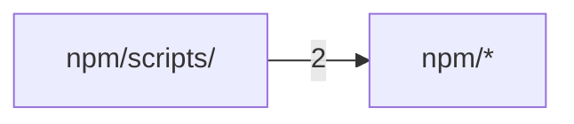

# 代码结构

[English](../structure.md) · **中文**

本页由 Codocia 根据代码自动生成，每次 build 重新计算：功能区划分、各区自带的说明、区之间的 import 依赖，以及讲解各区的页面。

范围内共 16 个文件，8,064 行；已排除 `Cargo.lock`、`LICENSE`、`.gitignore`、`homebrew-tap-template/**`、`docs/**`、`**/.DS_Store`

## 文件结构

**仓库根目录**

- （根目录文件） — 370 行，4 个文件。A notebook and compiler that turns what AI agents learn about a codebase into concise, sou…\
  讲解：[参与开发](04-contributing.md) (1)
- `.github/` — 264 行，2 个文件\
  讲解：[参与开发](04-contributing.md) (2)
- `src/` — 7,075 行，5 个文件。Library API for Codocia.\
  核心文件：`book.rs` `structure.rs` `lib.rs`\
  讲解：[概览](01-overview.md) (4), [证据与审阅](02-evidence.md) (5), [结构、翻译与构建](03-output.md) (4), [参与开发](04-contributing.md) (1)

**`npm/`**

- （直接文件） — 103 行，2 个文件。A notebook for AI coding agents that compiles source-grounded, drift-checked docs.\
  讲解：未讲解
- `bin/` — 25 行，1 个文件\
  讲解：[参与开发](04-contributing.md) (1)
- `scripts/` — 227 行，2 个文件\
  核心文件：`install.js`\
  讲解：[参与开发](04-contributing.md) (1)

## 依赖结构

箭头 A → B 表示 A 中有文件 import 了 B，数字是这样的文件级 import 数。只画最强的 1 条（共 1 条）。

